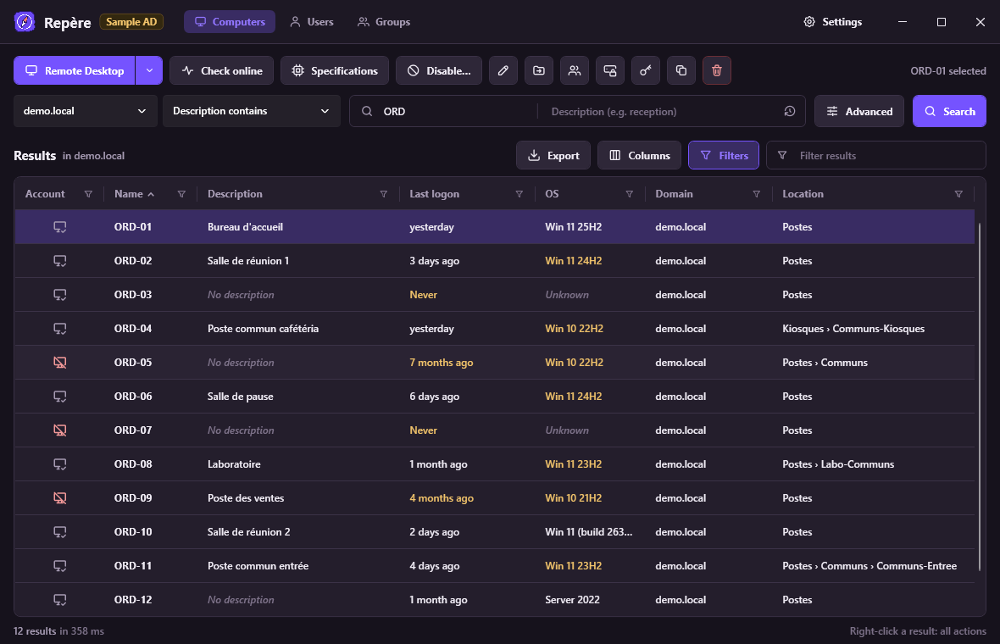

# 🧭 Repère

*[Français](README.md)*

The IT support tool for Active Directory. Find a computer, a user or a group from a few letters, in one domain or across the whole forest, then act on it without opening the console.

- **Computers**: search by name, description, IP address, list of names or BitLocker key ID. BitLocker keys, LAPS password, specifications, Remote Desktop, take control, restart, move to an OU, groups… all a right-click away.
- **Users**: unlock an account, give a new password that's easy to dictate, see why an account is locked out, and manage its groups.
- **Groups**: their members, from the whole forest, to add or remove.

Repère acts with **your** rights: what your account can't do in the console, Repère can't do either.

## Install

You need:

- Windows, on a computer **joined to the domain**;
- the **RSAT tools for Active Directory** (the ActiveDirectory PowerShell module);
- **PowerShell 7.5** or later. If it's missing, Repère.cmd offers to install it.

Then:

1. Download `Repere-<version>.zip` from the [Releases](https://github.com/reperedev/Repere/releases).
2. Extract it wherever you like, for example `C:\Tools\Repere`.
3. Double-click **Repère.cmd**. To keep it handy, pin Repère to the taskbar once it's open.

Repère follows Windows's language the first time: French or English. To switch, go to **Settings › Appearance › Language**. When a new version is out, a dot shows on **Settings**. Once it's installed, **What's new** shows its changes the first time it starts.

## First steps

1. **Choose where to search**: one domain, or **All domains** in the forest.
2. **Type a few letters** of a name (`ORD`) or a description (`reception`), then press Enter.
3. **Right-click** a result: every action is there, grouped by topic.

Switch pages with **Computers**, **Users** and **Groups** at the top of the window (Ctrl+1, Ctrl+2, Ctrl+3). Before disabling, moving or deleting anything, Repère asks you to confirm.

## Documentation

- [**Guide**](docs/en/guide.md): every page and action, with screenshots.
- [**Troubleshooting**](docs/en/troubleshooting.md): what Repère's messages mean, and what to do.
- [**Administration**](docs/en/administration.md): launch options, a shared shortcut, what the domain must allow, where Repère keeps its settings.
- [**Changelog**](CHANGELOG.en.md) (in French before 0.15.1): what changes from one version to the next.

## License

[MIT](LICENSE). The fonts in `src/fonts` are under the SIL Open Font License 1.1.
