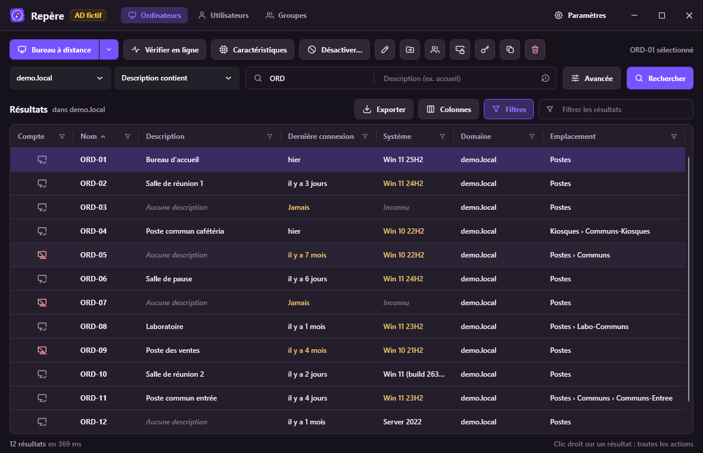

# 🧭 Repère

*[English](README.en.md)*

L'outil du soutien informatique pour Active Directory. Trouvez un ordinateur, un utilisateur ou un groupe en quelques lettres, dans un domaine ou dans toute la forêt, puis agissez dessus sans ouvrir la console.

- **Ordinateurs** : cherchez par nom, description, adresse IP, liste de noms ou ID de clé BitLocker. Clés BitLocker, mot de passe LAPS, caractéristiques, Bureau à distance, prise en main, redémarrage, déplacement d'OU, groupes… au clic droit.
- **Utilisateurs** : déverrouillez un compte, donnez un nouveau mot de passe facile à dicter, voyez pourquoi un compte est verrouillé et gérez ses groupes.
- **Groupes** : leurs membres, de toute la forêt, à ajouter ou retirer.

Repère agit avec **vos** droits : ce que votre compte ne peut pas faire dans la console, il ne le peut pas non plus.

## Installer

Il vous faut :

- Windows, sur un ordinateur **joint au domaine** ;
- les outils **RSAT pour Active Directory** (le module PowerShell ActiveDirectory) ;
- **PowerShell 7.5** ou plus récent. S'il manque, Repère.cmd propose de l'installer.

Puis :

1. Téléchargez `Repere-<version>.zip` dans les [Releases](https://github.com/reperedev/Repere/releases).
2. Extrayez-le où vous voulez, par exemple `C:\Outils\Repere`.
3. Double-cliquez sur **Repère.cmd**. Pour l'avoir sous la main, épinglez Repère à la barre des tâches une fois ouvert.

Quand une nouvelle version sort, un point apparaît sur **Paramètres**. Une fois installée, **Nouveautés** en montre les changements au premier lancement.

## Premiers pas

1. **Choisissez où chercher** : un domaine, ou **Tous les domaines** de la forêt.
2. **Tapez quelques lettres** d'un nom (`ORD`) ou d'une description (`accueil`), puis Entrée.
3. **Faites un clic droit** sur un résultat : toutes les actions sont là, groupées par sujet.

Changez de page avec **Ordinateurs**, **Utilisateurs** et **Groupes** en haut de la fenêtre (Ctrl+1, Ctrl+2, Ctrl+3). Avant de désactiver, déplacer ou supprimer, Repère demande confirmation.

## Documentation

- [**Guide**](docs/fr/guide.md) : chaque page et chaque action, avec des captures.
- [**Dépannage**](docs/fr/depannage.md) : ce que veulent dire les messages de Repère, et quoi faire.
- [**Administration**](docs/fr/administration.md) : options de lancement, raccourci partagé, ce que le domaine doit permettre, où Repère garde ses paramètres.
- [**Journal des versions**](CHANGELOG.md) : ce qui change d'une version à l'autre.

## Licence

[MIT](LICENSE). Les polices du dossier `src/fonts` sont sous licence SIL Open Font License 1.1.
