# Repère guide

*[Français](../fr/guide.md) · [Back to the README](../../README.en.md)*

- [The window](#the-window)
- [Computers](#computers)
  - [Searching](#searching)
  - [Acting on results](#acting-on-results)
  - [BitLocker keys](#bitlocker-keys)
  - [LAPS password](#laps-password)
  - [Specifications](#specifications)
  - [Take control](#take-control)
  - [Next name](#next-name)
- [Users](#users)
- [Groups](#groups)
- [Settings](#settings)
- [Keyboard shortcuts](#keyboard-shortcuts)

The screenshots use Repère's sample AD, whose descriptions and names are in French.

## The window

The window has three pages, **Computers**, **Users** and **Groups**, which all work the same way:

1. the **domain** to search, or **All domains**;
2. the **search type** (by name, by description…);
3. the **search box**, then Enter or **Search**.

Results show in a grid. Click a column to sort by it, and filter it (**Filters**); **Columns** picks which ones show, and **Export** saves the results shown as CSV: the columns shown, in their order, with the dates in full and each row's distinguished name last. The ↓ arrow in the search box brings back your **recent searches**.

A search that finds nothing says where it searched and suggests what to do next, such as **Search all domains**. What happens in the background (an action that finished, a computer that can't be reached) shows in a notification at the bottom of the window.

## Computers

### Searching

| Search type | To find |
|---|---|
| **Name contains** | computers whose name contains these letters: `ORD`, `ORD-01`. |
| **Description contains**, **starts with**, **ends with** | by the description in AD: `reception`, `Julie Bertrand`. |
| **No description** | the computers to describe. |
| **IP address** | the computer that has this address in DNS: `10.0.1.14`. |
| **List of names** | several computers at once: paste a list from a ticket or from Excel. Names not found show above the results, ready to copy. |
| **BitLocker key ID** | the computer whose BitLocker recovery screen shows this ID (at least the first 8 characters). |

**Advanced** adds criteria: the location (one OU, or OUs with a given name), the account's status, the OS and how long ago it last logged on.

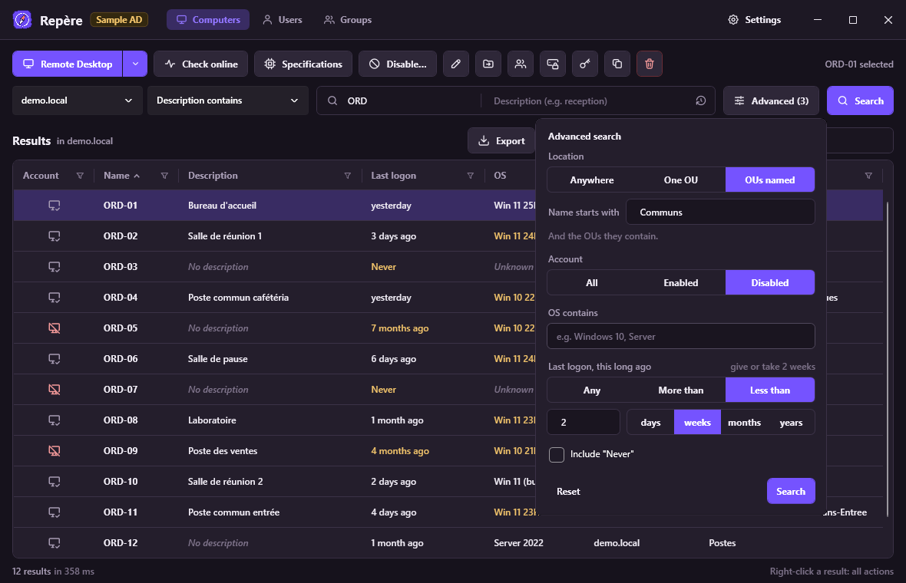

The **Online** column says whether the computer answers, with its IP address: a search that finds a single computer checks it on its own, and **Check online** does it for the selection. The **Account** column says whether the account is enabled in AD.

### Acting on results

Select one or more computers, then right-click (or use the bar above the results). The actions are grouped in four menus:

- **Active Directory**: edit the description, move to an OU, see the groups or add and remove several computers at once, enable or disable, delete from AD.
- **Keys and passwords**: BitLocker keys and LAPS password.
- **Remote tools**: Remote Desktop, take control, signed-in users, specifications, and the usual consoles (Computer Management, C$, Remote PowerShell, Services, Event Viewer, force policy update).
- **Restart**: restart with a message to the person, or cancel a planned restart.

The **Copy** submenu copies the name, the names on one line (separated by commas) or the rows, with the columns Export saves.

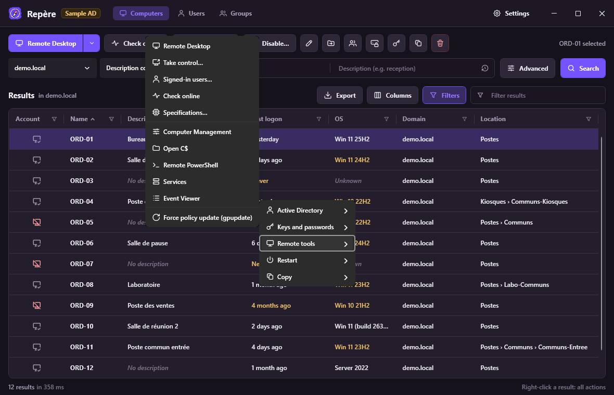

### BitLocker keys

The recovery keys of each disk, newest first. Old ones, left behind by a reinstall or a replaced disk, can be checked in one click (**Select old keys**) and deleted.

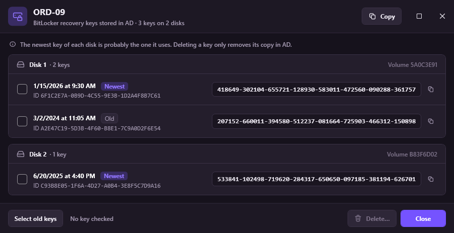

To find the computer from the blue recovery screen, search by **BitLocker key ID**.

### LAPS password

The local administrator's password, from Windows LAPS or legacy LAPS, for one or more computers. It stays hidden until you show it, and is neither saved nor logged.

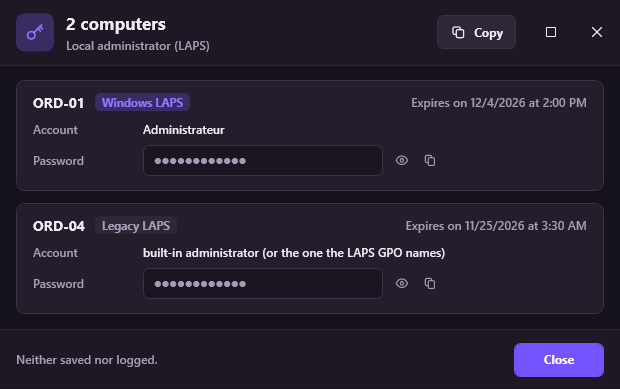

### Specifications

A computer's hardware, Windows, network, monitors, battery, docking station and installed programs, with what needs attention: a nearly full disk, a worn battery, a computer that hasn't restarted in a long time. Double-click a result to open it.

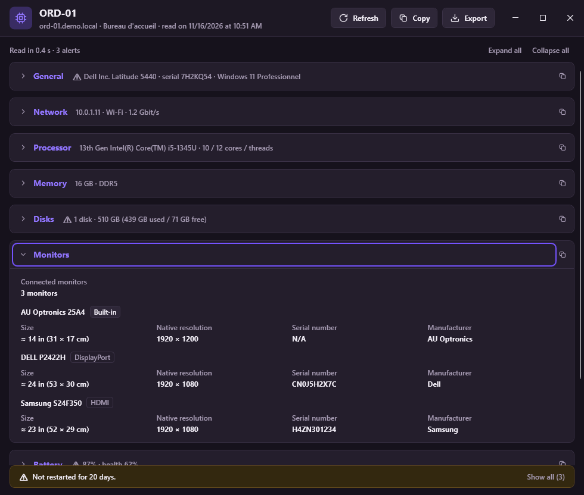

- **Copy** (Ctrl+C) gives the report as text, to paste into a ticket; **Export** saves it as JSON and text in `Documents\PCSpecs`; **Refresh** (F5) reads the computer again.
- Each section folds; **Collapse all** keeps only their summary.
- The window opens once the computer has been reached. If it's off, Repère says so within a few seconds. Without WinRM, Repère offers to turn it on for the reading (it's put back as it was when the window closes), or to **Read over DCOM**, which is slower.

### Take control

**Remote Desktop** opens a *new* session: the person at the computer loses their screen. **Take control…** joins *their* session instead, to watch or take control, with their consent. **Signed-in users…** only says who has a session open, without joining it.

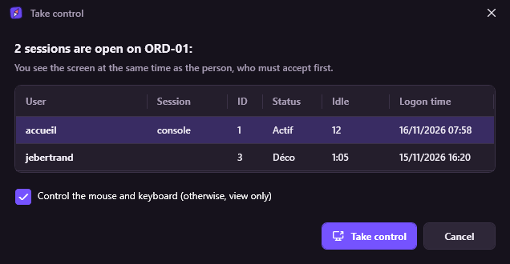

Take control needs a few settings in the domain: see [Administration](administration.md#take-control).

### Next name

**Next name**, in the action bar (or Ctrl+N), finds the next free name in a series, in AD and, if you want, in SCCM. Right-clicking a computer, **Next name in this series…**, opens it right on its series: `ORD-0143` gives `ORD-####`. The button does the same with a computer selected.

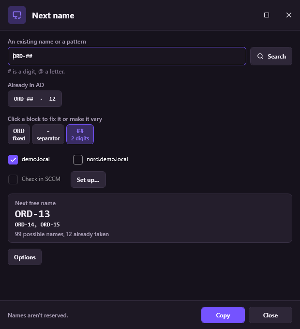

No syntax to learn:

- type the start of a name and click a series already in AD (`ORD-## · 13`);
- or type a real name, `ORD-0143`, which becomes `ORD-####`.

Repère shows the name in blocks: click a block to fix it or make it vary. To write a pattern yourself, `#` is a digit and `@` a letter: `ORD-@@@-####` gives `ORD-AAA-0001`, then `ORD-AAB-0001` after `ORD-AAA-9999`. **Options** picks a random order, fills gaps, starts at a given name or avoids characters (`IO0`).

Good to know:

- a disabled computer counts as taken;
- **Search** (or Enter) reads AD again, for a computer added since;
- the name is **not reserved**: someone else can take it in the meantime.

With SCCM, each name is **In SCCM**, **Not found in SCCM (with your access)**, or Repère **couldn't check SCCM**, with the reason. SCCM may show your account only some of the computers: a name it hides looks not found. It needs the site in **Settings › SCCM**, the Configuration Manager console on this computer, and read access to SCCM.

## Users

Type the start of the first name, last name, logon name or email: `bert` finds Julie and Jean Bertrand, `julie b` only Julie. **Locked out** and **Disabled** list all such accounts, and a list of logon names or emails finds them all at once.

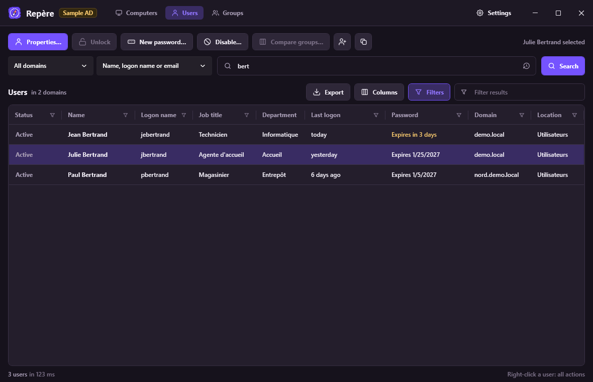

- **Unlock**, without touching the password.
- **New password…**: a generated password that's easy to dictate (`Apple-Cloud-Rabbit-47`), the default one from **Settings**, or another. It shows once and is saved nowhere.
- **Disable…** and **Enable**.
- **Properties…**: since when the account is locked out and why, when the account and the password expire, and its groups, direct or inherited, to add or remove.
- **Add to a group…** and **Remove from a group…**: several accounts at once. **Compare groups…** puts two users' groups side by side.
- **User's computers**: the computers whose description holds their name.

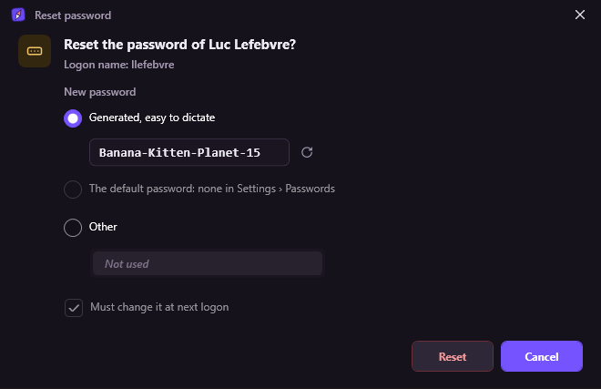

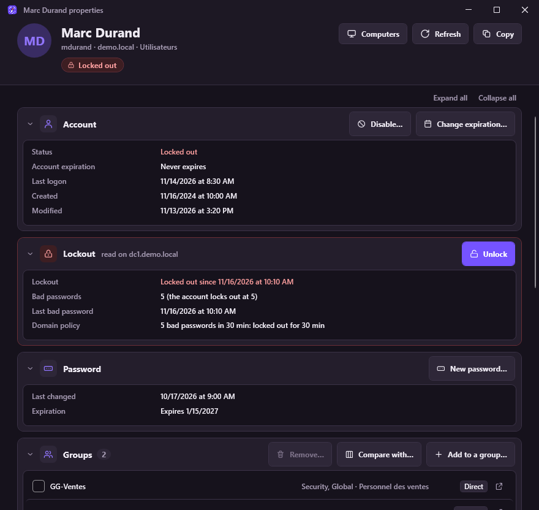

## Groups

Search by name or description, or find the groups with **No members**. **Properties…** lists the members, from the whole forest, and the groups this group belongs to; you can add and remove members there, and open a member with one click.

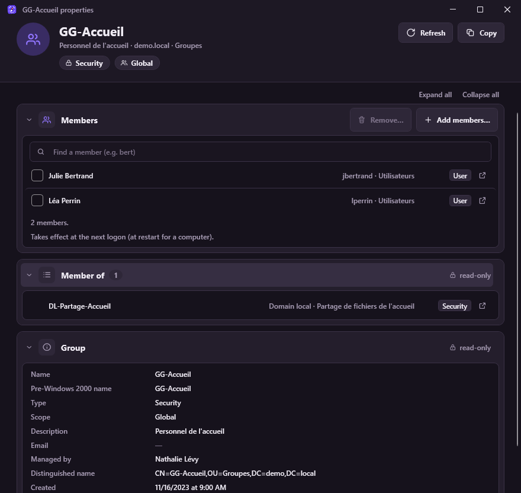

## Settings

The **Settings** button, at the top right, has these pages:

- **Appearance**: light or dark mode, themes (or your own, with the editor), font, text size, density, and the language, French or English.
- **Move to**: the OUs offered to move a computer to.
- **Restart**: the delay and message **Restart…** suggests.
- **Passwords**: a generated password, or always the same temporary password, kept encrypted for your Windows account.
- **SCCM**: the site code and server **Next name…** checks, with **Test**, which says whether the site answers, through which server, and whether this computer's inventory can be read.
- **Shortcuts**: the list of keyboard shortcuts.

Everything saves without a button: when you leave a box, change pages or close the window.

Under the version number, **What's new** shows what the version brought. That window also opens by itself the first time a new version starts.

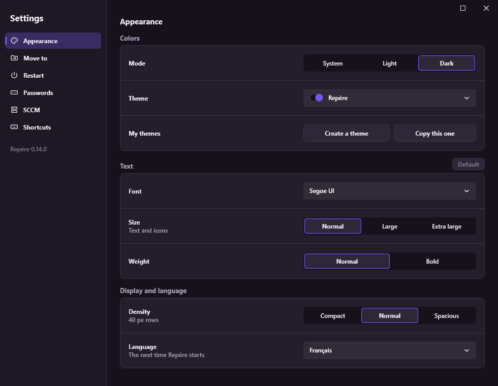

## Keyboard shortcuts

| Where | Keys | To |
|---|---|---|
| Main window | Ctrl+1, Ctrl+2, Ctrl+3 | Computers, Users, Groups |
| | Ctrl+F | Go to the search box |
| | Enter | Search |
| | F5 | Search again |
| | Esc | Stop the search |
| | Ctrl+N | Next name… (Computers page) |
| | ↓ (search box) | Recent searches |
| Results | ↓ ↑ | Go through the results |
| | Ctrl+A | Select all |
| | Ctrl+C | Copy the selected names (logon names on Users), or the selected text |
| | Ctrl+Shift+C | Copy the selected rows |
| | Drag over text | Select that text, to copy part of it |
| | Right-click or Shift+F10 | All actions |
| Computers | F2 | Edit description… |
| | Del | Delete from AD… (with confirmation) |
| | Double-click | Specifications… |
| Specifications | F5 | Read again |
| | Ctrl+C | Copy the report |
| | Esc | Stop reading, then close the window |
| Users and Groups | Double-click | Properties… |
| Properties | F5 | Read again |
| | Esc | Cancel the edit in progress, then close the window |
