# Guide de Repère

*[English](../en/guide.md) · [Retour au README](../../README.md)*

- [La fenêtre](#la-fenêtre)
- [Ordinateurs](#ordinateurs)
  - [Chercher](#chercher)
  - [Agir sur les résultats](#agir-sur-les-résultats)
  - [Clés BitLocker](#clés-bitlocker)
  - [Mot de passe LAPS](#mot-de-passe-laps)
  - [Caractéristiques](#caractéristiques)
  - [Prendre la main](#prendre-la-main)
  - [Prochain nom](#prochain-nom)
- [Utilisateurs](#utilisateurs)
- [Groupes](#groupes)
- [Paramètres](#paramètres)
- [Raccourcis clavier](#raccourcis-clavier)

## La fenêtre

La fenêtre a trois pages, **Ordinateurs**, **Utilisateurs** et **Groupes**, et le même fonctionnement sur chacune :

1. le **domaine** où chercher, ou **Tous les domaines** ;
2. le **type de recherche** (par nom, par description…) ;
3. le **champ de recherche**, puis Entrée ou **Rechercher**.

Les résultats s'affichent dans une grille. Chaque colonne se trie d'un clic et se filtre (**Filtres**) ; **Colonnes** choisit celles qui s'affichent, et **Exporter** enregistre les résultats affichés en CSV : les colonnes affichées, dans leur ordre, avec les dates en entier et le nom distinctif de chaque ligne en dernier. La flèche ↓ dans le champ de recherche rappelle les **recherches récentes**.

Une recherche qui ne trouve rien dit où elle a cherché et propose la suite, comme **Chercher dans tous les domaines**. Ce qui se passe en arrière-plan (une action finie, un ordinateur injoignable) s'affiche dans une notification, en bas de la fenêtre.

## Ordinateurs

### Chercher

| Type de recherche | Pour trouver |
|---|---|
| **Nom contient** | les ordinateurs dont le nom contient ces lettres : `ORD`, `ORD-01`. |
| **Description contient**, **commence par**, **termine par** | par la description dans l'AD : `accueil`, `Julie Bertrand`. |
| **Sans description** | les ordinateurs à décrire. |
| **Adresse IP** | l'ordinateur qui a cette adresse dans le DNS : `10.0.1.14`. |
| **Liste de noms** | plusieurs ordinateurs d'un coup : collez une liste. Les noms introuvables s'affichent au-dessus des résultats, à copier. |
| **ID de clé BitLocker** | l'ordinateur dont l'écran de récupération BitLocker montre cet ID (au moins les 8 premiers caractères). |

**Avancée** ajoute des critères : l'emplacement (une OU, ou les OU d'un nom donné), l'état du compte, le système et l'ancienneté de la dernière connexion.

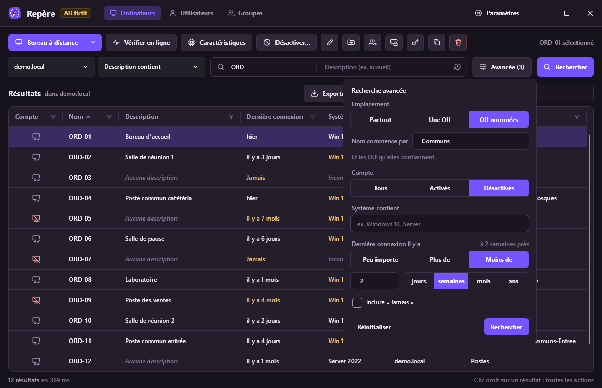

La colonne **En ligne** dit si l'ordinateur répond, avec son adresse IP : une recherche qui en trouve un seul le vérifie d'elle-même, et **Vérifier en ligne** le fait pour la sélection. La colonne **Compte** dit si le compte est activé dans l'AD.

### Agir sur les résultats

Sélectionnez un ou plusieurs ordinateurs, puis faites un clic droit (ou utilisez la barre au-dessus des résultats). Les actions sont groupées en quatre menus :

- **Active Directory** : modifier la description, déplacer vers une OU, voir les groupes ou ajouter et retirer plusieurs ordinateurs à la fois, activer ou désactiver, supprimer de l'AD.
- **Clés et mots de passe** : clés BitLocker et mot de passe LAPS.
- **Outils à distance** : Bureau à distance, prendre la main, utilisateurs connectés, caractéristiques, et les consoles habituelles (gestion de l'ordinateur, C$, PowerShell à distance, services, observateur d'événements, forcer les stratégies).
- **Redémarrage** : redémarrer avec un message à la personne, ou annuler un redémarrage prévu.

Le sous-menu **Copier** copie le nom, les noms sur une ligne (séparés par des virgules) ou les lignes, avec les colonnes qu'enregistre Exporter.

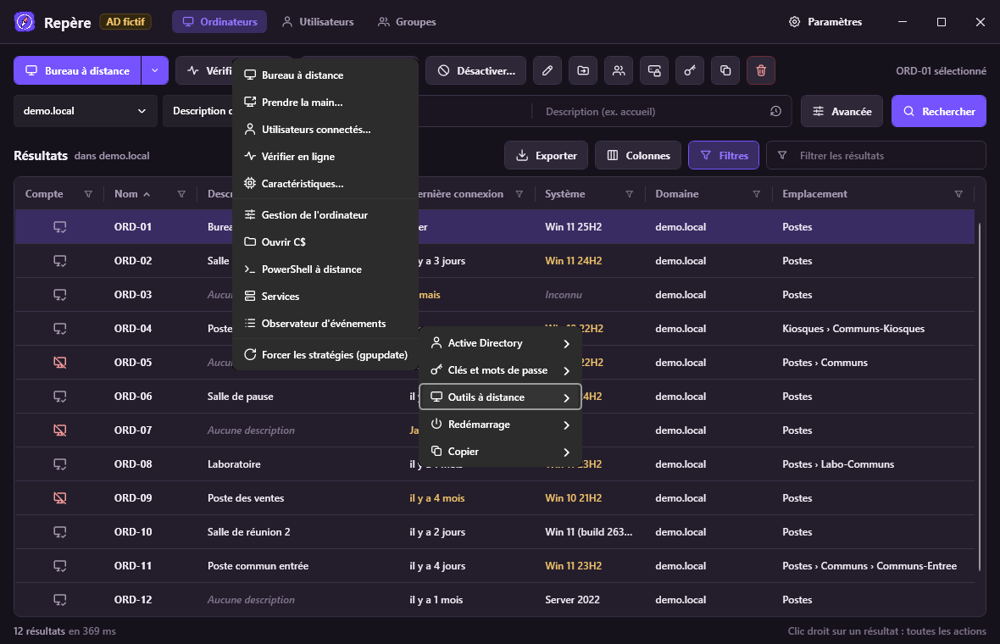

### Clés BitLocker

Les clés de récupération de chaque disque, la plus récente en premier. Les anciennes, laissées par une réinstallation ou un disque remplacé, se cochent d'un clic (**Sélectionner les anciennes**) pour être supprimées.

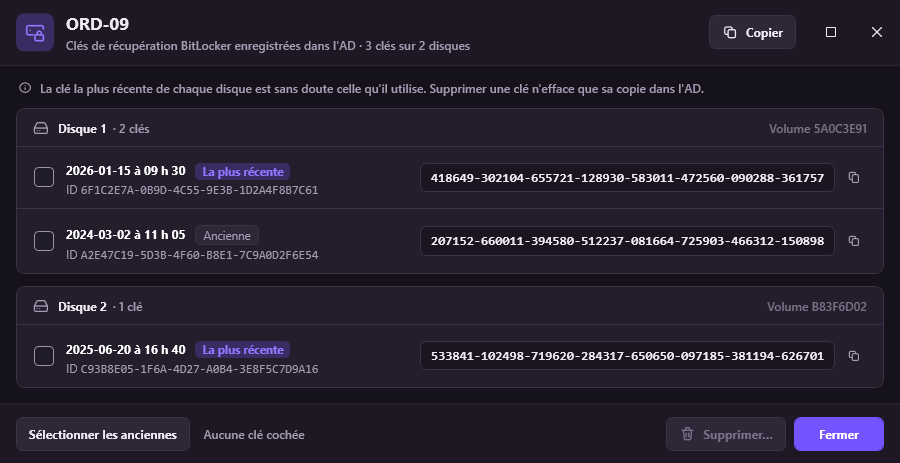

Pour retrouver l'ordinateur à partir de l'écran bleu de récupération, cherchez par **ID de clé BitLocker**.

### Mot de passe LAPS

Le mot de passe de l'administrateur local, de Windows LAPS comme du LAPS hérité, pour un ou plusieurs ordinateurs. Il est masqué jusqu'à ce que vous l'affichiez, et n'est ni enregistré ni journalisé.

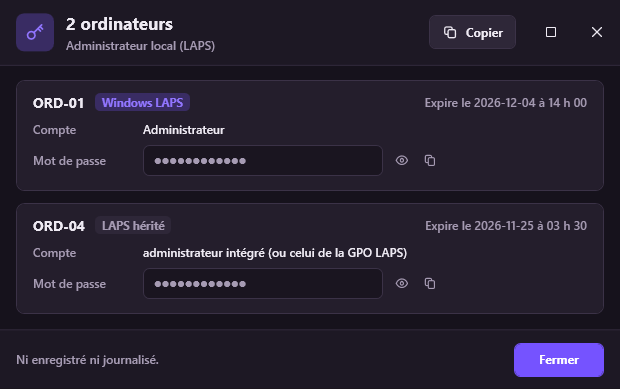

### Caractéristiques

Le matériel, Windows, le réseau, les écrans, la batterie, la station d'accueil et les logiciels installés d'un ordinateur, avec ce qui mérite attention : un disque presque plein, une batterie usée, un ordinateur pas redémarré depuis longtemps. Un double-clic sur un résultat l'ouvre.

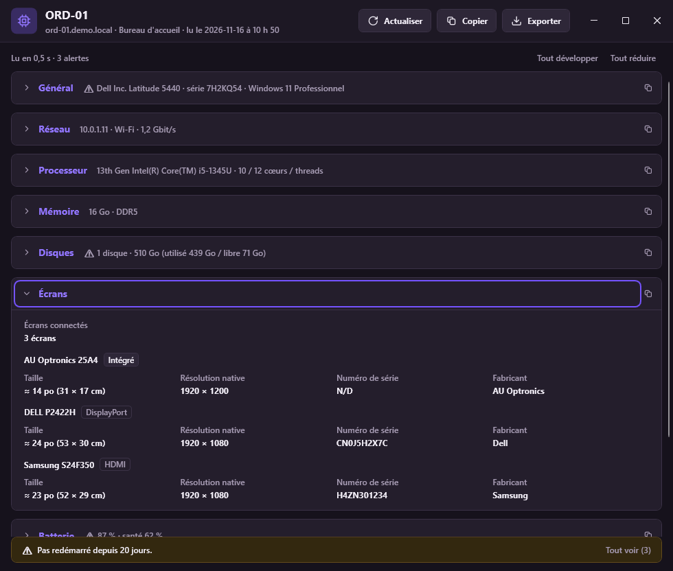

- **Copier** (Ctrl+C) donne le rapport en texte, à coller dans un ticket ; **Exporter** l'enregistre en JSON et en texte dans `Documents\PCSpecs` ; **Actualiser** (F5) relit l'ordinateur.
- Chaque section se replie ; **Tout réduire** ne garde que leur résumé.
- La fenêtre s'ouvre une fois l'ordinateur joint. Éteint, il le dit en quelques secondes. Sans WinRM, Repère propose de l'activer le temps de la lecture (il est remis comme avant à la fermeture), ou de **Lire par DCOM**, plus lentement.

### Prendre la main

**Bureau à distance** ouvre une *nouvelle* session : la personne devant l'ordinateur perd son écran. **Prendre la main…** rejoint plutôt *sa* session, pour regarder ou contrôler, avec son accord. **Utilisateurs connectés…** dit seulement qui a une session ouverte, sans la rejoindre.

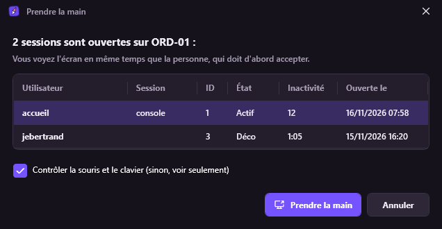

Prendre la main demande quelques réglages dans le domaine : voir [Administration](administration.md#prendre-la-main).

### Prochain nom

**Prochain nom**, dans la barre d'actions (ou Ctrl+N), trouve le prochain nom libre d'une série, dans l'AD et, si vous le voulez, dans SCCM. Un clic droit sur un ordinateur, **Prochain nom de cette série…**, l'ouvre directement sur sa série : `ORD-0143` donne `ORD-####`. Le bouton fait de même avec un ordinateur sélectionné.

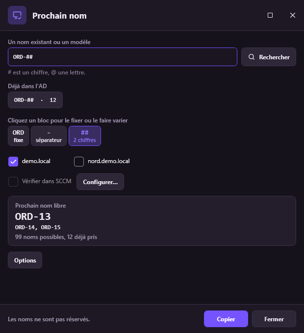

Pas de syntaxe à apprendre :

- tapez le début d'un nom et cliquez une série déjà dans l'AD (`ORD-## · 13`) ;
- ou tapez un vrai nom, `ORD-0143`, qui devient `ORD-####`.

Repère montre le nom en blocs : un clic fixe un bloc ou le fait varier. Pour écrire un modèle vous-même, `#` est un chiffre et `@` une lettre : `ORD-@@@-####` donne `ORD-AAA-0001`, puis `ORD-AAB-0001` après `ORD-AAA-9999`. **Options** choisit un ordre aléatoire, comble les trous, commence à un nom donné ou évite des caractères (`IO0`).

Bon à savoir :

- un ordinateur désactivé compte comme pris ;
- **Rechercher** (ou Entrée) relit l'AD, pour un ordinateur ajouté depuis ;
- le nom n'est **pas réservé** : quelqu'un d'autre peut le prendre entre-temps.

Avec SCCM, chaque nom est **Dans SCCM**, **Pas dans SCCM** ou **Vérification SCCM impossible**, avec la raison. Il faut le site dans **Paramètres › SCCM**, la console Configuration Manager sur cet ordinateur et des droits de lecture sur SCCM.

## Utilisateurs

Tapez le début du prénom, du nom, de l'identifiant ou du courriel : `bert` trouve Julie et Jean Bertrand, `julie b` seulement Julie. **Verrouillés** et **Désactivés** listent tous ces comptes, et une liste d'identifiants ou de courriels les cherche tous d'un coup.

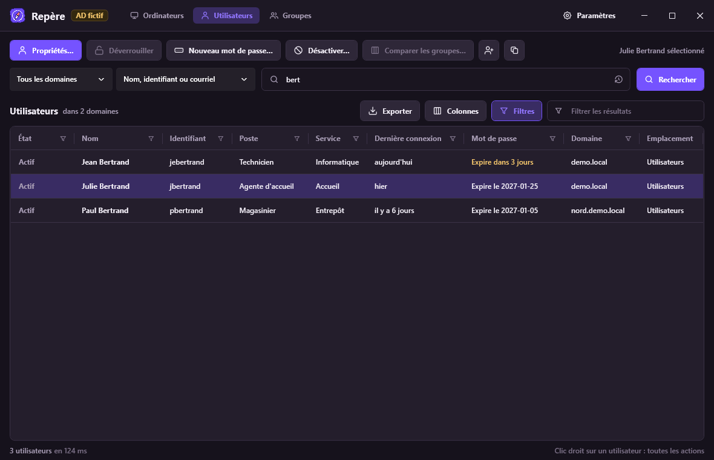

- **Déverrouiller**, sans toucher au mot de passe.
- **Nouveau mot de passe…** : un mot de passe généré et facile à dicter (`Pomme-Nuage-Lapin-47`), celui par défaut de **Paramètres**, ou un autre. Il s'affiche une fois et n'est enregistré nulle part.
- **Désactiver…** et **Activer**.
- **Propriétés…** : depuis quand le compte est verrouillé et pourquoi, l'expiration du compte et du mot de passe, et ses groupes, directs ou hérités, à ajouter ou retirer.
- **Ajouter à un groupe…** et **Retirer d'un groupe…** : plusieurs comptes à la fois. **Comparer les groupes…** met ceux de deux utilisateurs côte à côte.
- **Ordinateurs de l'utilisateur** : les ordinateurs dont la description contient son nom.

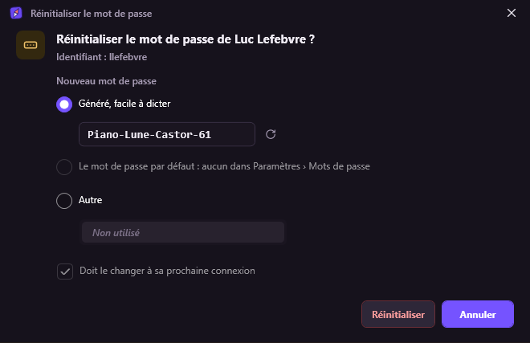

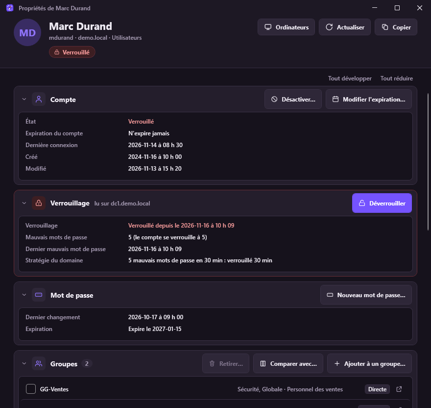

## Groupes

Cherchez par nom ou par description, ou trouvez les groupes **Sans membres**. **Propriétés…** liste les membres, de toute la forêt, et les groupes dont le groupe fait partie ; on y ajoute et retire des membres, et un membre s'ouvre d'un clic.

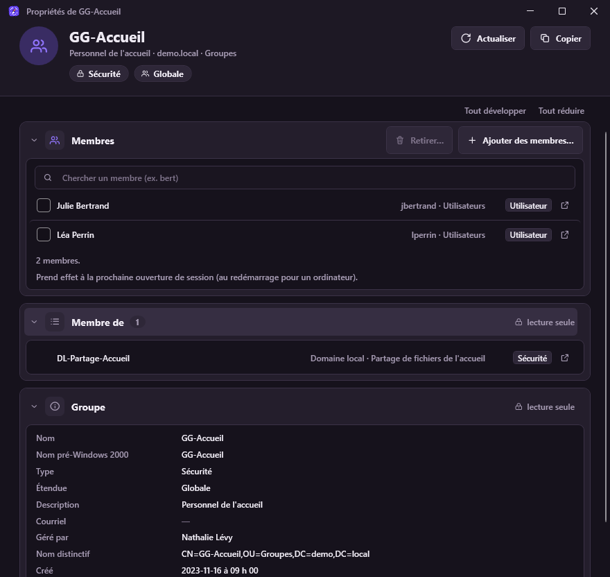

## Paramètres

Le bouton **Paramètres**, en haut à droite, a ces pages :

- **Apparence** : mode clair ou sombre, thèmes (ou les vôtres, avec l'éditeur), police, taille du texte, densité, et la langue, français ou anglais.
- **Déplacer vers** : les OU proposées pour déplacer un ordinateur.
- **Redémarrage** : le délai et le message proposés par **Redémarrer…**.
- **Mots de passe** : un mot de passe généré, ou toujours le même mot de passe temporaire, gardé chiffré pour votre compte Windows.
- **SCCM** : le code du site et le serveur où **Prochain nom…** vérifie, avec **Tester**.
- **Raccourcis** : la liste des raccourcis clavier.

Tout s'enregistre sans bouton : en quittant une case, en changeant de page ou en fermant la fenêtre.

Sous le numéro de version, **Nouveautés** montre ce que la version a apporté. Cette fenêtre s'ouvre aussi d'elle-même au premier lancement d'une nouvelle version.

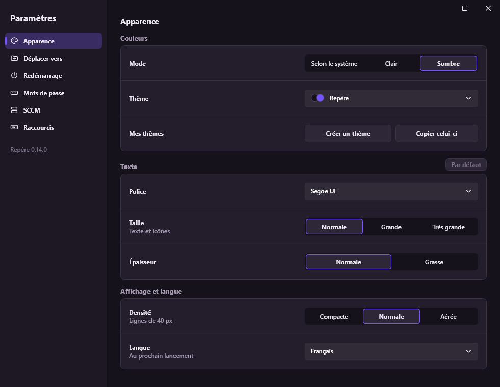

## Raccourcis clavier

| Où | Touches | Pour |
|---|---|---|
| Fenêtre principale | Ctrl+1, Ctrl+2, Ctrl+3 | Ordinateurs, Utilisateurs, Groupes |
| | Ctrl+F | Aller au champ de recherche |
| | Entrée | Rechercher |
| | F5 | Relancer la recherche |
| | Échap | Arrêter la recherche |
| | Ctrl+N | Prochain nom… (page Ordinateurs) |
| | ↓ (champ de recherche) | Recherches récentes |
| Résultats | ↓ ↑ | Parcourir les résultats |
| | Ctrl+A | Tout sélectionner |
| | Ctrl+C | Copier les noms sélectionnés (les identifiants sur Utilisateurs), ou le texte sélectionné |
| | Ctrl+Maj+C | Copier les lignes sélectionnées |
| | Glisser sur un texte | Sélectionner ce texte, pour en copier une partie |
| | Clic droit ou Maj+F10 | Toutes les actions |
| Ordinateurs | F2 | Modifier la description… |
| | Suppr | Supprimer de l'AD… (avec confirmation) |
| | Double-clic | Caractéristiques… |
| Caractéristiques | F5 | Lire de nouveau |
| | Ctrl+C | Copier le rapport |
| | Échap | Arrêter la lecture, puis fermer la fenêtre |
| Utilisateurs et Groupes | Double-clic | Propriétés… |
| Propriétés | F5 | Lire de nouveau |
| | Échap | Annuler la modification en cours, puis fermer la fenêtre |
